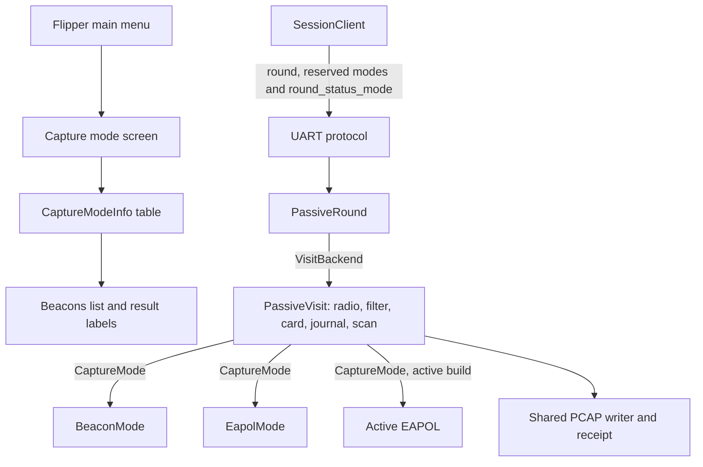

# Capture modes design

This document is the refactoring design for phase T10. It moves the beacon
capture behind a capture-mode contract on the ESP32 and behind a mode
descriptor in the Flipper app, so a future mode needs no change to the
round, the radio, the PCAP writer, or the journal. The requirement and the
screens are in [Capture modes on Flipper](ui-ux/capture-modes.md). The wire
format of the reserved commands is in the [UART protocol](uart.md#capture-modes).

Phase T10 built steps R1 to R4 below, and phase T11 built step R5 with the EAPOL
mode. Beacon behaves as before: the existing host tests pass unchanged, except
the menu and status checks that R4 and R5 update.

## Components after the refactoring

| Component | File | Owns |
| --- | --- | --- |
| `CaptureMode` contract | `firmware/esp32/session/capture_mode.h` | The calls a mode answers during one visit. It has no transmit operation; the architecture stage adds a transmit primitive to `ModeContext` for the active mode, not to this contract. |
| `BeaconMode` | `firmware/esp32/session/beacon_mode.h` | The T8 beacon capture. It wraps `PassiveSession` and changes none of its logic. |
| Shared PCAP writer | `firmware/esp32/storage/pcap_record.h` | One sealed PCAP per visit, the frame-type check, and the closed-file receipt. |
| `PassiveVisit` | `firmware/esp32/airrounds_uart/passive_visit.h` | Radio, receive filter, queue, card mount, journal, and scan. It calls the mode and the writer. |
| `PassiveRound` | `firmware/esp32/uart/passive_round.h` | Visit order, round deadline, and point results. It takes the mode of a round and sets the per-mode budget: 10 s per point for Beacon, 60 s for EAPOL and for the active mode. |
| Mode descriptor | `flipper/capture_mode.h` | Labels, availability, and the meaning of success for each mode. |
| Capture mode screen | `flipper/airrounds.cpp` | The menu item, the screen, the locks, and the local choice. |

`PassiveSession` keeps its public interface, so
`tests/storage/passive_session_test.cpp` runs unchanged. Its `save` now calls
the shared writer, which writes the same bytes.

## The capture-mode contract

`PassiveVisit` drives one mode per visit through these calls.

| Call | Context | Rule |
| --- | --- | --- |
| `needs()` | UART loop and save task | Returns the frame types the mode needs. `PassiveVisit` sets the receive filter from it, and the writer checks the records against it. |
| `reset()` | UART loop | Clears the previous visit. The radio is detached and any save has finished. |
| `begin(target, budgetUs)` | Under the receive lock | Arms the visit. `budgetUs` is the point's share of the round. |
| `onFrame(frame, size, channel, elapsedUs)` | Wi-Fi receive callback, under the receive lock | Returns true for an accepted frame. It must not allocate, write to the card, log, or block. |
| `done(elapsedUs)` | Under the receive lock | Returns true when the mode needs no more frames. |
| `finish()` | UART loop, after reception stops | Returns a `ModeResult`. |
| `recordCount()`, `record(index)` | Save task, after `found` | The frames to save, in capture order. |

The mode owns the frame buffers. It sizes them at compile time, because the
callback cannot allocate. A mode that needs more memory than the board has
free must say so in its admission entry. The current firmware uses 54,256 of
65,536 bytes of global RAM, including the EAPOL mode's four 512-byte buffers.

### Frame types

A mode declares the IEEE 802.11 frame types it needs as a mask:
`managementFrames`, `controlFrames`, and `dataFrames`. Beacon declares
management frames only. The declaration has two effects.

1. `PassiveVisit` builds the promiscuous receive filter from it. The radio
   delivers no other type to the callback. Control frames also need the
   per-subtype filter, so `PassiveVisit` sets it to every control subtype
   when a mode declares them. `WIFI_PROMIS_FILTER_MASK_DATA` passes data
   frames. Only the management path has run on hardware.
2. The shared writer refuses a record of an undeclared type. It refuses the
   whole set before it creates the file, so a mode cannot save a frame it did
   not declare, even after a parsing defect.

A mode that declares a type other than management frames needs an admission
entry first. See [Admission checklist](#admission-checklist).

### Chains of frames

A future mode can save one frame or a chain of related frames from one
visit. The writer saves all records of the visit in one PCAP, in the order
that `record(index)` returns them, each with its own timestamp. The receipt
covers the whole file. A set with zero records creates no file.

The visit still owns one file: `visit-<boot>-<session>-<slot>.pcap`. The Mac
check `tools/mac/check_pcap.py` accepts a beacon or a probe response for the
BSSID, or with `--eapol` the EAPOL-Key handshake frames for it. A mode that saves
other frames needs its own Mac criterion before its results count as verified.

### Results

`PassiveVisit::beginSave` maps the mode's result to the point result that the
existing replies carry.

| `ModeResult` | Point result | Digit in `aps` |
| --- | --- | --- |
| `found` | `saved` after the writer verifies the closed file, else `storage_error` | `2` or `4` |
| `not_observed` | `not_observed` | `1` |
| `absence_confirmed` | `not_observed` in the existing replies | `1`; `5` in the reserved `round_status_mode` |
| `error` | `radio_error`, which ends the round | `3` |

`storage_error` never comes from the mode. The writer returns it for a
failed file, and `PassiveVisit` returns it when the save task, the file path,
or the card mount fails. The journal records the same result as the reply.

## The Flipper descriptor

`flipper/capture_mode.h` holds one `CaptureModeInfo` per mode: the label of
every slot in the scan path, the meaning of success, the wire ID, and two
flags. `implied` marks a mode that every board supports. `implemented` marks
a mode the app can run. Beacon is both. EAPOL is implemented but not implied, so
the screen offers it only once the board lists it. The active EAPOL mode fills
Todo B. The app marks it implemented but not implied, so the screen offers it only
on a board that lists it, which only the opt-in active build does. A default-build
board does not list it, so the screen shows the slot with **Soon**.

| Function | Rule |
| --- | --- |
| `modeAvailable(mode, board)` | The app implements the mode, and the mode is implied or the board lists it in its `modes` reply. |
| `modeOf(wireId)` | The descriptor for the mode the board reports. An unknown ID returns the neutral labels. |
| `pointResult`, `pointDetail` | Take the descriptor and map a point result to its label slot by the meaning of success. |

`roundMode` returns the mode a `round_status_mode` reply reports for the round,
and the chosen mode until the first such reply names it. `boardModes` returns the
IDs the board lists. Both live in `flipper/airrounds.cpp`.

The progress counter counts a point as a success by the mode's meaning:
`savedPoints` counts `saved` for a frame-found mode such as Beacon or EAPOL, and
digit `5` (`absence_confirmed`) for a future absence mode.

## Protocol reservation

The [UART protocol](uart.md#capture-modes) defines feature bit 5, the
`modes` read command, an optional `mode <id>` tail on `round`, the
`round_status_mode` read command, and result digit `5`. The board and the app
implement them.

The Flipper parser `readReplyDetails` in `firmware/esp32/uart/uart_reply.h`
parses the `mode <id>` marker before `aps`, under feature bit 5, and accepts
result digit `5` only in a reply that carried that marker. Every other reply
keeps the digit-`4` ceiling.

The board keeps the round fields off a rejected reply, so a non-`ok` reply ends
at the feature byte. A host test builds the longest `round_status_mode` reply for
every reply code and asserts that each fits `wireReplyCapacity` (240 with the
terminator); the longest measured reply is 223 bytes. Without the drop, a
rejected `round_status_mode` reply with the full round fields would leave no spare
byte, and the client would report a lost link.

## Admission checklist

Record these answers in this document, under a heading for the mode, before
the mode is built. A mode without an entry stays unavailable.

- Transmission: a passive mode confirms that it needs no transmission; the
  contract has no transmit call, and the mode adds none. An active mode instead
  declares its transmit path, its confinement to the opt-in build, and its
  compliance with [active operation](acceptable-use.md#active-operation).
- Frame types: list the types the mode declares and why it needs each one.
- Records: say whether it saves one frame or a chain, the largest chain, and
  the RAM it needs.
- Identifiers: list the addresses and fields that reach the PCAP, the
  journal, and the Flipper screen. Client MAC addresses never reach the
  screen.
- Target: confirm that the mode drops every frame whose BSSID is not the
  access point it is visiting, as Beacon does in `PassiveSession::receive`.
- Payload: state that the mode decrypts nothing and derives no key. A mode may
  save handshake frames on an own or permitted network, for research use,
  receive-only, and with no decryption. It saves only the raw frame bytes. Raw
  handshake frames carry key-derived values, so the entry states how
  [acceptable use](acceptable-use.md#capture-modes-in-scope) treats them.
- Evidence: define what the Mac checks for a success. For an absence mode,
  define the evidence of absence; see [Open questions](#open-questions).
- Legal basis: an own network, or a network whose owner permits the test in
  writing, under the scope and limits in [acceptable use](acceptable-use.md).
- Active transmit, for an active mode only: state the frame it transmits, the
  target selection, the burst size, the per-round cap, the auto-stop and
  kill-switch behaviour, and the audit record. Confirm the transmit is a targeted
  unicast deauthentication frame only, under
  [active operation](acceptable-use.md#active-operation).

### EAPOL mode

The mode records the EAPOL-Key frames of the WPA 4-way handshake for the round's
target access point.

- **Receive only.** The mode needs no transmission. The contract has no transmit
  call, and the mode adds none. It waits for a client to join on its own and
  records the handshake the join produces. It never forces a reconnect.
- **Frame types.** The mode declares `dataFrames` only. An EAPOL frame is a data
  frame that carries the IEEE 802.1X ethertype `0x88 0x8e` after its LLC/SNAP
  header. The receive filter passes `WIFI_PROMIS_FILTER_MASK_DATA`. The mode
  needs no management or control frames.
- **Records.** The mode saves a chain of one to four frames, one per handshake
  message held. Each frame buffer is 512 bytes, and the mode keeps four of them,
  so the chain costs 2,048 bytes of static RAM plus the per-message size and
  timestamp. The mode drops a frame larger than 512 bytes and never truncates it,
  so the PCAP never holds a partial record. `make embedded` is the memory gate.
- **Identifiers.** The PCAP holds the whole EAPOL frames, so the target BSSID,
  the client MAC address, and the EAPOL-Key fields reach the card. The journal
  records the target BSSID and the channel, as for Beacon. The Flipper screen
  shows the per-point result label only. No client MAC address reaches the
  screen.
- **Target.** The mode drops every frame whose BSSID, taken by the DS bits, is
  not the access point the visit targets. It drops a 4-address WDS frame, which
  has no single BSSID.
- **Payload.** The mode decrypts nothing and derives no key, PMK, PTK, PMKID, or
  passphrase. It saves only the raw frame bytes. Those bytes carry key-derived
  values: message 1 can carry the PMKID, and messages 2 to 4 carry the MIC.
  Either value allows an offline guess of the passphrase, so
  [acceptable use](acceptable-use.md#capture-modes-in-scope) treats the capture
  as being as sensitive as the passphrase, and
  [data handling](acceptable-use.md#data-handling) governs it.
- **Evidence.** A point succeeds when the mode saves at least one EAPOL-Key frame
  for the target; the point result `saved` reports that saved frame, not a
  completed join. The Mac check `tools/mac/check_pcap.py --eapol` confirms that
  every saved frame is an EAPOL-Key frame for the target BSSID. It reports which
  handshake messages the file holds per client, and whether one client completed
  a join.
- **Legal basis.** An own network, or a network whose owner permits the test in
  writing, under the scope and limits in [acceptable use](acceptable-use.md).

### Active EAPOL mode

The mode transmits a targeted unicast deauthentication frame to force a client
off the round's target access point, then records the EAPOL-Key frames of the
rejoin. It fills the Todo B slot. It exists only in the opt-in active build; the
default build excludes it. The requirements are in [T12](t12.md).

- **Transmission.** The mode transmits, unlike every passive mode. It sends a
  unicast deauthentication frame to one client of the target access point. The one
  `esp_wifi_80211_tx` call site lives in a reviewed file outside the default gate's
  `firmware/esp32/` scan root, compiled only into the opt-in active build. The
  architecture stage adds the transmit primitive to a `ModeContext`, through the R6
  `poll` call; the current contract has no transmit call.
- **Target client.** The mode learns the target client passively, and only from an
  uplink data frame of the target access point: ToDS set and FromDS clear, so the
  client is the transmitter address (addr2). A transmitter address is always an
  individual address, so the target is never a group address. The mode rejects a
  candidate that is group-addressed, equal to the target BSSID, or all zero. It
  ignores downlink, IBSS, and WDS frames for selection. It deauthenticates that one
  client only, and never broadcasts.
- **Capture before transmit.** The mode checks for a captured handshake before it
  arms the burst. A client already mid-join, whose EAPOL-Key frame arrives before
  the burst fires, suppresses the transmit: the mode captures it with no transmit.
  No qualifying client within the budget means no target, no transmit, and a
  `not_observed` result. The mode cannot deauthenticate a client it never saw.
- **Transmit bounds.** The mode sends a burst of 3 deauthentication frames, 100 ms
  apart. If no EAPOL-Key frame arrives within 5 s, it sends one more burst, for at
  most 2 bursts per visit. A per-round cap of 30 frames, for 5 points at 2 bursts of
  3 frames, bounds a whole round. The burst size, the re-burst wait, the per-visit
  burst count, and the per-round cap are compile-time constants, not operator
  settings.
- **Auto-stop and kill.** The mode stops transmitting once it records any
  EAPOL-Key frame for the target, within one poll cycle. Auto-stop gates the transmit only; the capture
  runs for the rest of the budget, so messages 2 to 4 arrive passively. A
  deauthentication frame sent during the handshake would abort it, so the mode must
  not transmit once a handshake has begun. A stop request from Flipper ends the
  transmit at once.
- **Early finish.** The visit ends as soon as it holds a crackable set for the
  target: message 1 carrying a PMKID, or messages 1 and 2 from one client. The
  round then moves to the next network and shares the remaining time. This exits
  earlier than the passive EAPOL rule, which waits for messages 3 and 4, so a round
  of several networks finishes sooner. The mode overrides `done()` for this rule,
  and still saves every message it captured before the exit.
- **Timing.** The mode uses the 60 s point budget of passive EAPOL. The burst runs
  in the first second. The rest of the budget captures the rejoin.
- **Frame types.** The mode declares `dataFrames`, as passive EAPOL does. The
  receive filter passes `WIFI_PROMIS_FILTER_MASK_DATA`. It needs no management or
  control receive.
- **Records.** The saved records are the EAPOL-Key frames, one to four, exactly as
  passive EAPOL saves them. The mode does not save the frames it transmits; the
  journal records those instead.
- **Identifiers.** The PCAP holds the handshake frames, so the target BSSID, the
  client MAC address, and the EAPOL-Key fields reach the card, as for passive
  EAPOL. The journal holds the transmit audit, because a deauthentication frame is
  a management frame and the mode declares `dataFrames` only: the shared writer's
  frame-type gate and the `check_pcap.py --eapol` invariant both refuse a
  management frame in the capture PCAP, so a transmitted frame never reaches it.
  The audit records the reason code, the frame count, the target BSSID, the target
  client MAC address, and a timestamp per transmitted frame. No client MAC address
  reaches the Flipper screen.
- **Target.** The mode drops every received frame whose BSSID is not the target,
  as passive EAPOL does, and it transmits only to a client of the target.
- **Payload.** The mode decrypts nothing and derives no key. It saves only the raw
  handshake frame bytes. The deauthentication frame carries no key material: it is
  a fixed 26-byte management frame with a reason code, built from the IEEE 802.11
  standard.
- **Evidence.** A point succeeds when the mode saves at least one EAPOL-Key frame
  for the target, as passive EAPOL. `saved` means at least one EAPOL-Key frame, not
  a complete handshake; `check_pcap.py --eapol` reports whether a client completed a
  join. A client that ignores the deauthentication under 802.11w, or reassociates
  without a full 4-way handshake, produces no handshake, which is `not_observed`,
  not an error. The architecture stage defines the Mac check that verifies the
  journal transmit audit.
- **Legal basis.** An own network, or a network whose owner permits active
  transmission in writing, under
  [active operation](acceptable-use.md#active-operation). The operator attestation
  precedes the round.

## Invariants

The default build keeps what the [security assurance gap](t9.md#security-assurance-gap)
relies on. The active build confines its one transmit path instead; see
[active operation](acceptable-use.md#active-operation).

- The radio starts in `WIFI_MODE_NULL` with a promiscuous receive callback.
- The default build's firmware source has no frame-transmit call such as
  `esp_wifi_80211_tx`. `tests/mac/test_receive_only.py` fails the build on an
  unreviewed radio call or a non-`WIFI_MODE_NULL` radio mode under
  `firmware/esp32/`. The active build's one reviewed transmit file holds the sole
  `esp_wifi_80211_tx` call, outside that `firmware/esp32/` scan root, and the active
  gate variant proves no other file transmits. The active build opens the radio in
  `WIFI_MODE_STA`, confined to `firmware/active/`, so the interface exists for the
  transmit; the default build never leaves `WIFI_MODE_NULL`. The
  [hardware bench](t12.md#hardware-bench) confirms the transmit.
- The receive filter passes the declared frame types only. For Beacon and
  for the scan it passes management frames only, as before.
- `onFrame` runs under `receiveLock_` in the Wi-Fi callback. A mode that
  needs work outside the callback gets a `poll` call with step R6, not
  callback time. The active mode drives its timed deauthentication transmit from
  `poll`, never from `onFrame`.

A future passive mode may capture handshake frames under the four limits in
[acceptable use](acceptable-use.md). The no-transmit and `WIFI_MODE_NULL`
invariants above hold for such a mode too. The active mode (Todo B) is the
exception: it transmits a targeted deauthentication frame in a separate opt-in
build, under [active operation](acceptable-use.md#active-operation). The
[active EAPOL mode](#active-eapol-mode) entry and the default-build scoping above
define it. See [T12](t12.md).

## Implementation steps

| Step | Status | Content |
| --- | --- | --- |
| R1 | Built in T10 | The shared writer `pcap_record.h` with frame-type check and chains, the contract, and `BeaconMode`. `tests/storage/capture_mode_test.cpp` checks that `BeaconMode` and `PassiveSession` accept the same frames and close the window at the same time, and that the file has the T9 header and frame bytes. `tests/uart/capture_mode_labels_test.cpp` checks the mode table, availability, label slots, and the result reset. |
| R2 | Built in T10 | `PassiveVisit` calls the mode and the writer and sets the receive filter from `needs()`. The ESP32 image builds. |
| R3 | Built in T10 | The Flipper descriptor and labels from it. The screens show the same Beacon labels. |
| R4 | Built in T10 | The **Capture mode** menu item, the menu scroll, the screen, its locks, and the reset of point results on a change. The UI emulator checks the menu, the screen, and the Board state unknown and Session active locks. `capture_mode_labels_test.cpp` checks every row of the lock table, including Scan active, which no screen can reach while a scan runs. |
| R5 | Built in T11 | Feature bit 5, `modes`, the `mode` tail, `round_status_mode`, digit `5`, **Mode pending**, and the return to Beacon. |
| R6 | Planned in T12 | `poll(nowUs, context)` for work outside the callback, and a `ModeContext` with `tune(channel)` and `note(key, value)`. Time spent in `tune` counts against the point budget and the T8 fair share. The active EAPOL mode is the first mode that needs R6: `ModeContext` gains a transmit primitive for the deauthentication burst. |

T11 built R5 with the EAPOL mode. R6 comes with the active EAPOL mode in T12,
which transmits its deauthentication burst from `poll`, outside the receive
callback.

## Hardware check

T10 ran on the bench with two builds. Both showed the menu, the
**Capture mode** screen, and the **Not available yet** hint as the
requirement specifies, and both saved a Beacon round. The
[T10 acceptance report](t10.md) lists the builds, the evidence, and the open
checks.

## Built tests for R5

T11 built these; they run under `make check`.

- Parse the `mode` tail, and return `conflict` on a repeat with another mode.
- A board without bit 5 stays on Beacon and gets no `modes` read.
- Labels follow `mode <id>` from the reply after the app reopens.
- Start is hidden and the list shows **Mode pending** until the `modes` reply.
- Stop in a non-Beacon round after a confirmed absence keeps the link: the
  `round_stop` reply carries `1`, and `round_status_mode` carries `5`.
- A board flashed without bit 5 returns the choice to Beacon without a `modes`
  read.
- The source check `tests/mac/test_receive_only.py` fails on a transmit call or
  a non-`WIFI_MODE_NULL` radio mode under `firmware/esp32/`.

## Future tests

- Each new mode: the writer refuses its undeclared types, and the Mac check
  accepts its files.

## Risks

- The `v` scroll mark of the three-row lists sits at y = 49 and touches the
  highlight of the third row, as it did in T9. The four-row menu draws its
  mark at y = 63, below the last row.
- Two feature bits remain free after bit 5: `40` and `80`. One bit covers
  every mode, and the `modes` reply lists them.
- A chain larger than the free RAM cannot be held in the callback. Its
  admission entry states the bound.
- Channel changes inside a visit affect the T8 adaptive windows. R6 defines
  the limits before a mode tunes.

## Open questions

| Question | Needed before |
| --- | --- |
| The name and the behaviour of Todo B | Resolved: the [active EAPOL mode](#active-eapol-mode) fills it. |
| Cross-round dedup of captured networks | Deferred: within-round no-repeat covers the main case, and re-running a profile is an explicit operator choice. |
| The evidence that the Mac checks for a confirmed absence | The first absence mode |
