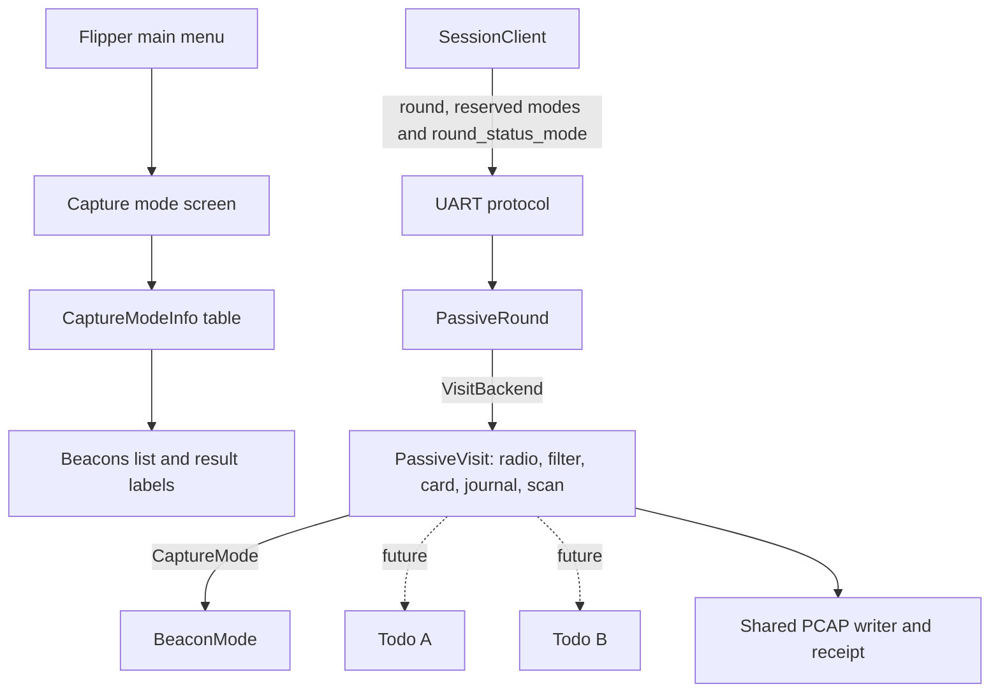

# Capture modes design

This document is the refactoring design for phase T10. It moves the beacon
capture behind a capture-mode contract on the ESP32 and behind a mode
descriptor in the Flipper app, so a future mode needs no change to the
round, the radio, the PCAP writer, or the journal. The requirement and the
screens are in [Capture modes on Flipper](ui-ux/capture-modes.md). The wire
format of the reserved commands is in the [UART protocol](uart.md#reserved-capture-modes).

Phase T10 built steps R1 to R4 below. Beacon behaves as before: the existing
host tests pass unchanged, except the menu checks in the UI emulator that
R4 updates. The protocol reservation, step R5, is documentation only.

## Components after the refactoring

| Component | File | Owns |
| --- | --- | --- |
| `CaptureMode` contract | `firmware/esp32/session/capture_mode.h` | The calls a mode answers during one visit. It has no transmit operation. |
| `BeaconMode` | `firmware/esp32/session/beacon_mode.h` | The T8 beacon capture. It wraps `PassiveSession` and changes none of its logic. |
| Shared PCAP writer | `firmware/esp32/storage/pcap_record.h` | One sealed PCAP per visit, the frame-type check, and the closed-file receipt. |
| `PassiveVisit` | `firmware/esp32/airrounds_uart/passive_visit.h` | Radio, receive filter, queue, card mount, journal, and scan. It calls the mode and the writer. |
| `PassiveRound` | `firmware/esp32/uart/passive_round.h` | Visit order, round deadline, and point results. Unchanged. |
| Mode descriptor | `flipper/capture_mode.h` | Labels, availability, and the meaning of success for each mode. |
| Capture mode screen | `flipper/airrounds.cpp` | The menu item, the screen, the locks, and the local choice. |

`PassiveSession` keeps its public interface, so
`tests/storage/passive_session_test.cpp` runs unchanged. Its `save` now calls
the shared writer, which writes the same bytes.

## The capture-mode contract

`PassiveVisit` drives one mode per visit through these calls.

| Call | Context | Rule |
| --- | --- | --- |
| `needs()` | UART loop and save task | Returns the frame types the mode needs. `PassiveVisit` sets the receive filter from it, and the writer checks the records against it. |
| `reset()` | UART loop | Clears the previous visit. The radio is detached and any save has finished. |
| `begin(target, budgetUs)` | Under the receive lock | Arms the visit. `budgetUs` is the point's share of the round. |
| `onFrame(frame, size, channel, elapsedUs)` | Wi-Fi receive callback, under the receive lock | Returns true for an accepted frame. It must not allocate, write to the card, log, or block. |
| `done(elapsedUs)` | Under the receive lock | Returns true when the mode needs no more frames. |
| `finish()` | UART loop, after reception stops | Returns a `ModeResult`. |
| `recordCount()`, `record(index)` | Save task, after `found` | The frames to save, in capture order. |

The mode owns the frame buffers. It sizes them at compile time, because the
callback cannot allocate. A mode that needs more memory than the board has
free must say so in its admission entry. The current firmware uses 52,160 of
65,536 bytes of global RAM.

### Frame types

A mode declares the IEEE 802.11 frame types it needs as a mask:
`managementFrames`, `controlFrames`, and `dataFrames`. Beacon declares
management frames only. The declaration has two effects.

1. `PassiveVisit` builds the promiscuous receive filter from it. The radio
   delivers no other type to the callback. Control frames also need the
   per-subtype filter, so `PassiveVisit` sets it to every control subtype
   when a mode declares them. `WIFI_PROMIS_FILTER_MASK_DATA` passes data
   frames. Only the management path has run on hardware.
2. The shared writer refuses a record of an undeclared type. It refuses the
   whole set before it creates the file, so a mode cannot save a frame it did
   not declare, even after a parsing defect.

A mode that declares a type other than management frames needs an admission
entry first. See [Admission checklist](#admission-checklist).

### Chains of frames

A future mode can save one frame or a chain of related frames from one
visit. The writer saves all records of the visit in one PCAP, in the order
that `record(index)` returns them, each with its own timestamp. The receipt
covers the whole file. A set with zero records creates no file.

The visit still owns one file: `visit-<boot>-<session>-<slot>.pcap`. The Mac
check `tools/mac/check_pcap.py` accepts only a beacon or a probe response for
the BSSID today. A mode that saves other frames needs its own Mac criterion
before its results count as verified.

### Results

`PassiveVisit::beginSave` maps the mode's result to the point result that the
existing replies carry.

| `ModeResult` | Point result | Digit in `aps` |
| --- | --- | --- |
| `found` | `saved` after the writer verifies the closed file, else `storage_error` | `2` or `4` |
| `not_observed` | `not_observed` | `1` |
| `absence_confirmed` | `not_observed` in the existing replies | `1`; `5` in the reserved `round_status_mode` |
| `error` | `radio_error`, which ends the round | `3` |

`storage_error` never comes from the mode. The writer returns it for a
failed file, and `PassiveVisit` returns it when the save task, the file path,
or the card mount fails. The journal records the same result as the reply.

## The Flipper descriptor

`flipper/capture_mode.h` holds one `CaptureModeInfo` per mode: the label of
every slot in the scan path, the meaning of success, the wire ID, and two
flags. `implied` marks a mode that every board supports. `implemented` marks
a mode the app can run. Beacon is both. Todo A and Todo B are neither, so the
screen shows them with **Soon**.

| Function | Rule |
| --- | --- |
| `modeAvailable(mode, board)` | The app implements the mode, and the mode is implied or the board lists it in its `modes` reply. |
| `modeOf(wireId)` | The descriptor for the mode the board reports. An unknown ID returns the neutral labels. |
| `pointResult`, `pointDetail` | Take the descriptor and map a point result to its label slot by the meaning of success. |

The app runs every round as Beacon until the protocol carries a mode, because
no board reports one. `roundMode` and `boardModes` in `flipper/airrounds.cpp`
are the two places that read the board once it does.

The progress counter counts `saved` points. An absence mode needs digit `5`
to count its successes. The counter changes with step R5.

## Protocol reservation

The [UART protocol](uart.md#reserved-capture-modes) reserves feature bit 5,
the `modes` read command, an optional `mode <id>` tail on `round`, the
`round_status_mode` read command, and result digit `5`. No board or app
implements them yet.

The existing replies keep their formats. The Flipper parser
`readReplyDetails` in `firmware/esp32/uart/uart_reply.h` requires `aps` right
after `journal` and `interrupted`, and it rejects a result digit above `4`. A
new field in an existing reply would make the current app drop the reply and
report a lost link. So the mode travels only in new commands.

The reply budget is 239 bytes from `!` through the line feed
(`wireReplyCapacity` = 240 with the terminator). The board appends the round
fields by command, whatever the reply code, so a rejected read also carries
them. A `round_status_mode` reply with code `unsupported_version`, state
`complete`, result `not_observed`, `journal failed`, `interrupted 0`,
`mode 00`, and five points takes exactly 239 bytes. Today's longest
`round_status_detail` reply takes 231 bytes.

So the reservation leaves no spare byte. Before R5 adds `mode` or any later
field, it must keep the round fields off a rejected reply, or the board drops
that reply and the client reports a lost link.

## Admission checklist

Record these answers in this document, under a heading for the mode, before
the mode is built. A mode without an entry stays unavailable.

- Receive only: confirm that the mode needs no transmission. The contract has
  no transmit call, and the mode adds none.
- Frame types: list the types the mode declares and why it needs each one.
- Records: say whether it saves one frame or a chain, the largest chain, and
  the RAM it needs.
- Identifiers: list the addresses and fields that reach the PCAP, the
  journal, and the Flipper screen. Client MAC addresses never reach the
  screen.
- Target: confirm that the mode drops every frame whose BSSID is not the
  access point it is visiting, as Beacon does in `PassiveSession::receive`.
- Payload: state that the mode decrypts nothing and derives no key. A mode may
  save handshake frames on an own or permitted network, for research use,
  receive-only, and with no decryption. It saves only the raw frame bytes. Raw
  handshake frames carry key-derived values, so the entry states how
  [acceptable use](acceptable-use.md#capture-modes-in-scope) treats them.
- Evidence: define what the Mac checks for a success. For an absence mode,
  define the evidence of absence; see [Open questions](#open-questions).
- Legal basis: an own network, or a network whose owner permits the test in
  writing, under the scope and limits in [acceptable use](acceptable-use.md).

## Invariants

The refactoring keeps what the [security assurance gap](t9.md#security-assurance-gap)
relies on.

- The radio starts in `WIFI_MODE_NULL` with a promiscuous receive callback.
- The firmware source has no frame-transmit call such as `esp_wifi_80211_tx`.
- The receive filter passes the declared frame types only. For Beacon and
  for the scan it passes management frames only, as before.
- `onFrame` runs under `receiveLock_` in the Wi-Fi callback. A mode that
  needs work outside the callback gets a `poll` call with step R6, not
  callback time.

A future mode may capture handshake frames under the four limits in
[acceptable use](acceptable-use.md). The no-transmit and `WIFI_MODE_NULL`
invariants above hold for such a mode too.

## Implementation steps

| Step | Status | Content |
| --- | --- | --- |
| R1 | Built in T10 | The shared writer `pcap_record.h` with frame-type check and chains, the contract, and `BeaconMode`. `tests/storage/capture_mode_test.cpp` checks that `BeaconMode` and `PassiveSession` accept the same frames and close the window at the same time, and that the file has the T9 header and frame bytes. `tests/uart/capture_mode_labels_test.cpp` checks the mode table, availability, label slots, and the result reset. |
| R2 | Built in T10 | `PassiveVisit` calls the mode and the writer and sets the receive filter from `needs()`. The ESP32 image builds. |
| R3 | Built in T10 | The Flipper descriptor and labels from it. The screens show the same Beacon labels. |
| R4 | Built in T10 | The **Capture mode** menu item, the menu scroll, the screen, its locks, and the reset of point results on a change. The UI emulator checks the menu, the screen, and the Board state unknown and Session active locks. `capture_mode_labels_test.cpp` checks every row of the lock table, including Scan active, which no screen can reach while a scan runs. |
| R5 | Reserved | Feature bit 5, `modes`, the `mode` tail, `round_status_mode`, digit `5`, **Mode pending**, and the return to Beacon. |
| R6 | With the first mode that needs it | `poll(nowUs, context)` for work outside the callback, and a `ModeContext` with `tune(channel)` and `note(key, value)`. Time spent in `tune` counts against the point budget and the T8 fair share. |

R5 and R6 come with the first real mode. Building them now would add code
that no mode uses and no test can reach on hardware.

## Hardware check

T10 ran on the bench with two builds. Both showed the menu, the
**Capture mode** screen, and the **Not available yet** hint as the
requirement specifies, and both saved a Beacon round. The
[T10 acceptance report](t10.md) lists the builds, the evidence, and the open
checks.

## Future tests

- R5: parse the `mode` tail, and return `conflict` on a repeat with another
  mode.
- R5: a board without bit 5 stays on Beacon and gets no `modes` read.
- R5: labels follow `mode <id>` from the reply after the app reopens.
- R5: Start is hidden and the list shows **Mode pending** until the `modes`
  reply arrives.
- R5: Stop in a non-Beacon round after a confirmed absence keeps the link.
  The `round_stop` reply carries `1`, and `round_status_mode` carries `5`.
- R5: a board flashed without bit 5 returns the choice to Beacon without a
  `modes` read.
- Source check: a test fails when `firmware/esp32/**` contains a transmit
  call.
- Each new mode: the writer refuses its undeclared types, and the Mac check
  accepts its files.

## Risks

- The `v` scroll mark of the three-row lists sits at y = 49 and touches the
  highlight of the third row, as it did in T9. The four-row menu draws its
  mark at y = 63, below the last row.
- Two feature bits remain free after bit 5: `40` and `80`. One bit covers
  every mode, and the `modes` reply lists them.
- A chain larger than the free RAM cannot be held in the callback. Its
  admission entry states the bound.
- Channel changes inside a visit affect the T8 adaptive windows. R6 defines
  the limits before a mode tunes.

## Open questions

| Question | Needed before |
| --- | --- |
| The names and the behaviour of Todo A and Todo B | The first real mode |
| The evidence that the Mac checks for a confirmed absence | The first absence mode |
| Which control or data frames a future mode needs | Its admission entry |
